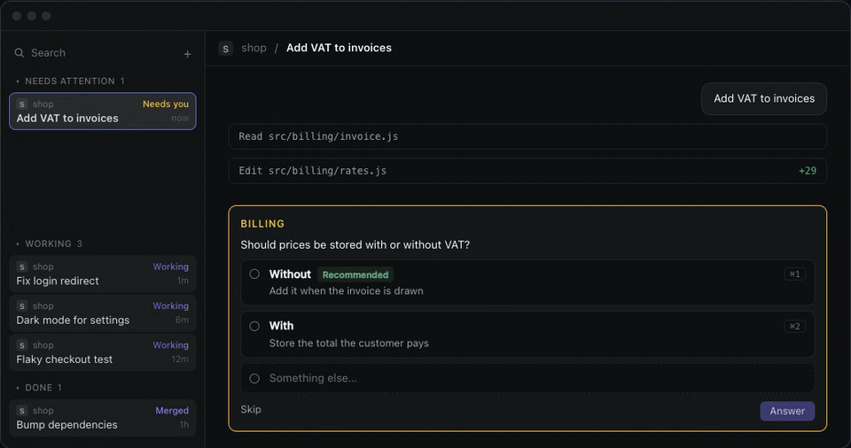
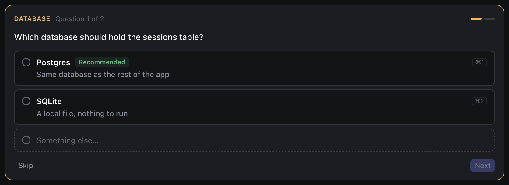
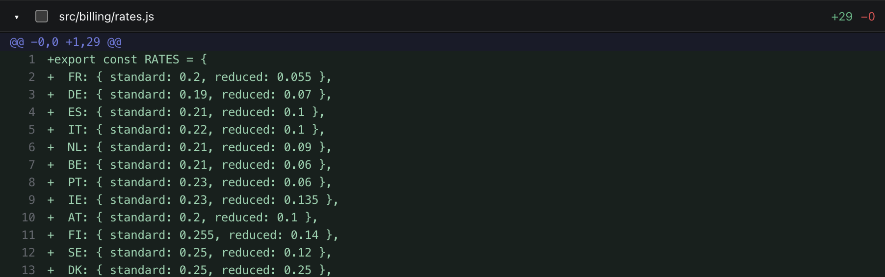
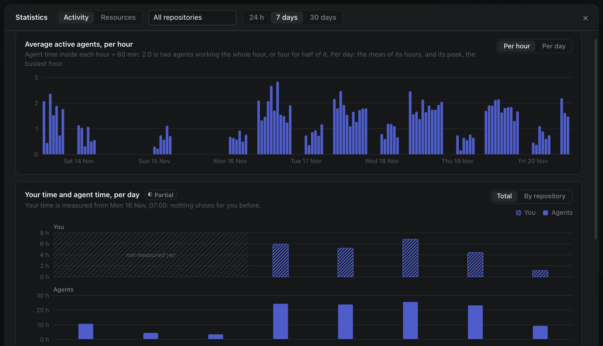

# Control Room

**Run more agents. See only what needs you.**

A macOS app that runs Claude Code and Codex in parallel, each task in its own git worktree. It calls you only when an agent needs you, and each thread ends as a merged pull request.

**[Get Control Room →](https://nightshiftfactory.com/controlroom/)** Free · macOS on Apple Silicon

## Calls you / Stays quiet

| Calls you | Stays quiet |
|---|---|
| An agent asks a question | Tests and builds in the background |
| A tool needs your approval | A script you launched |
| A turn is finished | An agent merging its own pull request |
| An app is open for you to look at | A thread you snoozed |
| A run failed or is blocked | Everything still working |

## Key features

- **One keystroke per task.** Type what you want: Control Room creates the worktree, names the branch and starts the agent. Start from a sentence, a Linear or GitHub issue, or a pull request.
- **One list, sorted by what waits on you.** Threads sort themselves into Needs attention, Working and Done. <kbd>⌘J</kbd> jumps to the next one that needs you; **Where are we?** says where a thread stands.
- **One next action, or none.** Create PR, Fix CI, Address review, Resolve conflicts, Merge. Or **Start & merge**, and the agent takes it all the way.
- **Agents find the next task.** An agent proposes a new thread for what does not belong in its own, with the brief written. You press Start.
- **Designs you can click, diagrams you can read.** Agents show a new screen as a live mockup before they build it, and explain with Mermaid diagrams.
- **Made for many agents.** With several Claude accounts, Auto starts each thread on the one with the most left before its reset. Threads can wait for each other, and agents can start and message other threads.

Every feature: [nightshiftfactory.com/controlroom/features.html](https://nightshiftfactory.com/controlroom/features.html).

## Requirements

- A Mac with Apple Silicon
- git
- The `claude` or `codex` command line, signed in
- The GitHub CLI `gh`, for pull requests

## FAQ

**Where does my code go?** Nowhere new. Agents work in git worktrees on your Mac and talk to their own provider, as they do in your terminal. A cloud thread runs in the agent provider's cloud, when you choose it.

**Is it free?** Yes, for now: Control Room is free to download and use. You still pay your own agent providers, with the Claude and Codex subscriptions or API keys you already have. The app's code is closed; this repository (the plugin catalog and docs) is MIT.

**Why sign in with GitHub to download?** It is how the app gets its updates: the same account connects Control Room to them. Any GitHub account works, it costs nothing, and the signed-in account has no access to anything else. See the [privacy policy](https://nightshiftfactory.com/controlroom/privacy.html).

## Feedback

Found a bug or want a feature? [Open an issue](https://github.com/Tenjin-Tech/control-room/issues/new/choose), or use **Feedback** in the app: point at the part that is wrong and it files the issue for you. Questions and ideas go to [Discussions](https://github.com/Tenjin-Tech/control-room/discussions). See [CONTRIBUTING.md](CONTRIBUTING.md).

## Community plugins

[`plugins.json`](plugins.json) lists the community plugins Control Room can install, in **Settings › Community plugins**.

| Plugin | What it does |
|---|---|
| [PR Lens](https://github.com/Tenjin-Tech/control-room-pr-lens) | Agents draw each code change they make as one picture in the thread. |

A plugin installs off. It runs only after you turn it on, and any change to its files turns it off until you approve it again.

### Add yours

1. Start from [control-room-sample-plugin](https://github.com/Tenjin-Tech/control-room-sample-plugin). The plugin API is in [docs/plugins.md](docs/plugins.md).
2. Publish a GitHub release whose tag is the manifest's `version` (for example `0.1.0`), with the plugin's files attached. Control Room installs the files of that release.
3. Open a pull request that adds an entry to `plugins.json`: `id` (the manifest's), `name`, `author`, `description`, `repo` (`owner/name`).

Your README must say what the plugin sends over the network and why, and whether it needs an account or payment.

## Links

[Website](https://nightshiftfactory.com/controlroom/) · [Discussions](https://github.com/Tenjin-Tech/control-room/discussions) · [Legal notice](https://nightshiftfactory.com/controlroom/legal.html)

## License

This repository (the plugin catalog and docs) is under the [MIT license](LICENSE). The Control Room app is free and closed source, published by Tenjin Tech.
